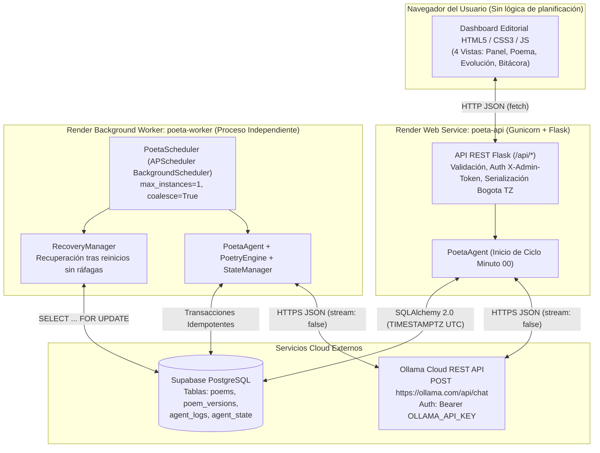
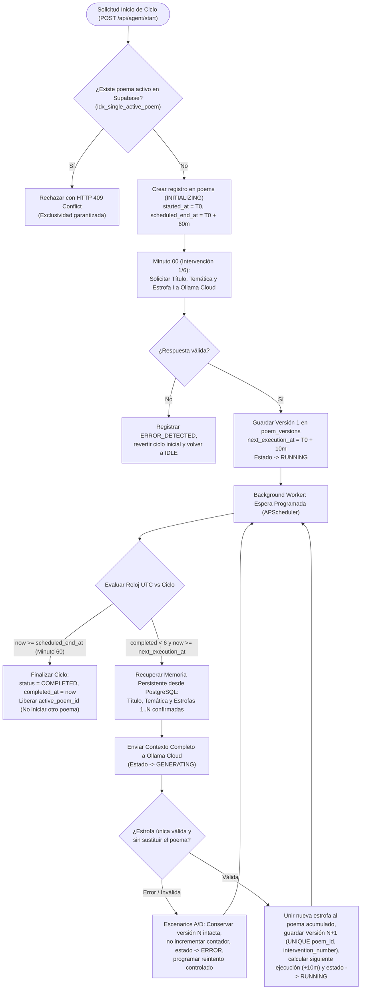
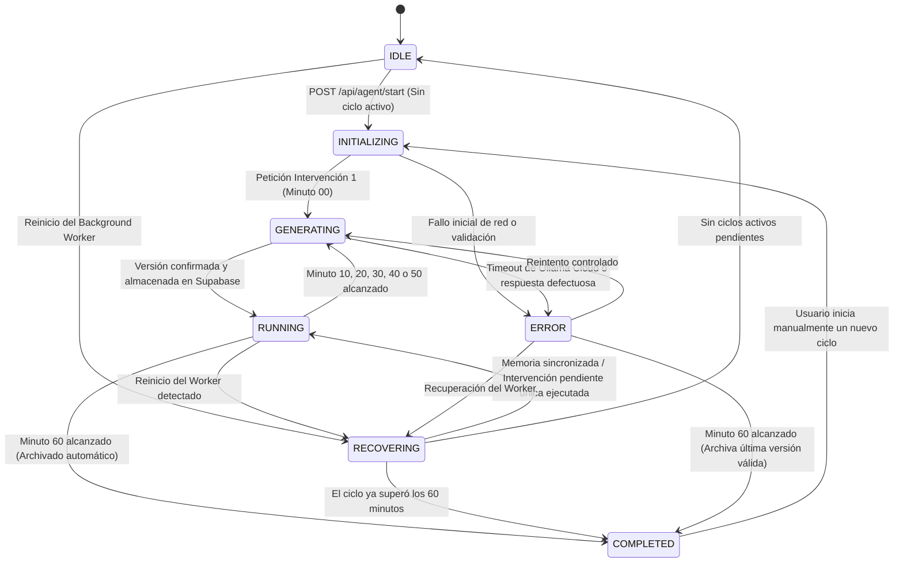
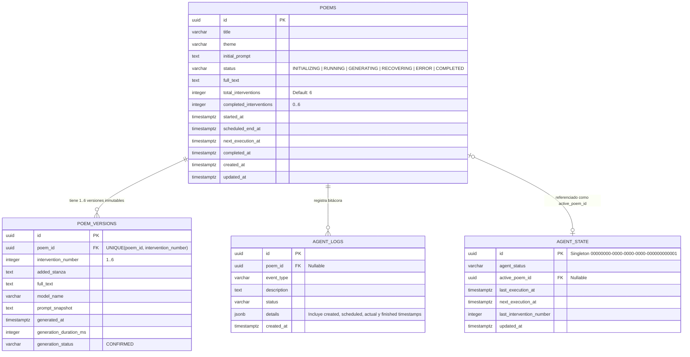
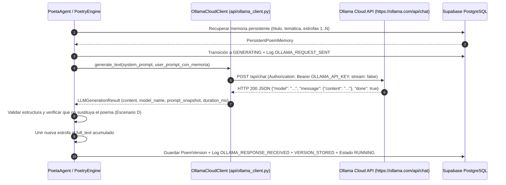
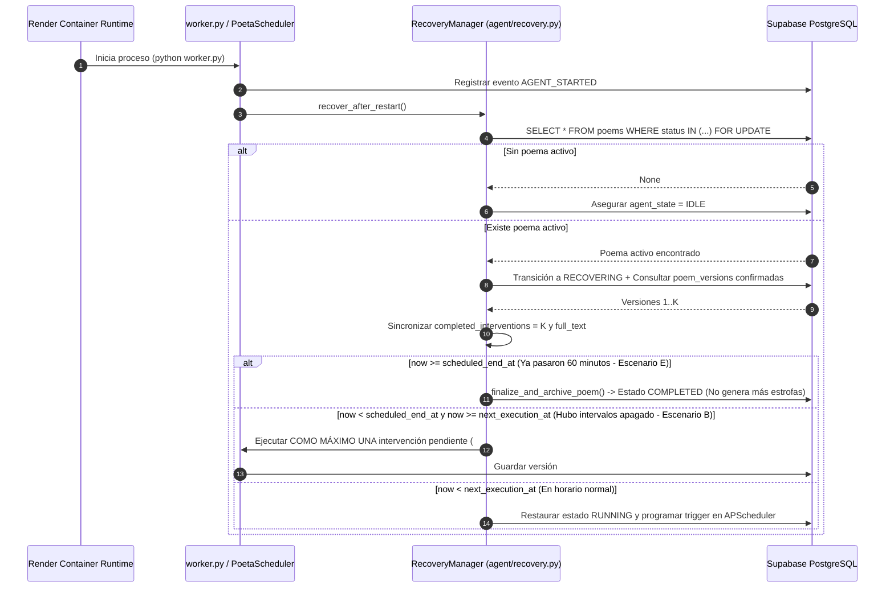

# Documentación Técnica de Arquitectura y Evidencias — POETA

Este documento detalla la arquitectura interna, la máquina de estados, el modelo relacional de datos, los protocolos de comunicación con **Ollama Cloud** y **Supabase PostgreSQL**, y la guía de verificación de evidencias de funcionamiento de **POETA: Agente Persistente de Creación Literaria Autónoma**.

---

## 1. Diagrama de Arquitectura del Sistema



---

## 2. Diagrama de Flujo del Agente (Ciclo de 60 Minutos)



---

## 3. Diagrama de la Máquina de Estados Controlada



---

## 4. Modelo Entidad-Relación (Supabase PostgreSQL)



---

## 5. Flujo de Comunicación con Ollama Cloud



---

## 6. Flujo de Recuperación de Memoria tras Reinicio del Worker



---

## 7. Guía de Evidencias de Funcionamiento

A continuación se documentan las estructuras reales verificables que genera el sistema durante su operación para las evidencias académicas:

### 7.1. Ejemplo de Petición Real a Ollama Cloud (`POST https://ollama.com/api/chat`)
```json
{
  "model": "gemma3:27b",
  "messages": [
    {
      "role": "system",
      "content": "Eres POETA, un escritor y poeta literario hispanoamericano de alta sensibilidad estética. Tu misión es componer una obra poética original en español a lo largo de seis intervenciones. Mantienes una voz lírica coherente, imágenes evocadoras, ritmo cuidado y progresión temática. Nunca incluyes saludos, explicaciones técnicas, notas al pie ni comentarios externos a la obra."
    },
    {
      "role": "user",
      "content": "Continuación de creación poética — Intervención 2 de 6.\n\n=== MEMORIA PERSISTENTE DEL POEMA ===\nTítulo: Liturgia del Reloj de Arena\nTemática: La persistencia de la memoria frente al paso inexorable del tiempo.\nEstrofas completadas hasta ahora (1 de 6):\n\n[Estrofa 1]\nCae la arena fina en el cristal dormido,\ncomo un río secreto que numera la sombra,\ny en cada grano leve que se juzga perdido\nlate un eco antiguo que en silencio nos nombra.\n=====================================\n\nDirectriz literaria para esta intervención:\nSegunda estrofa (Minuto 10): expande la imagen inicial y profundiza en el motivo central sin repetir versos previos."
    }
  ],
  "stream": false,
  "options": {
    "temperature": 0.75
  }
}
```

### 7.2. Ejemplo de Respuesta de Ollama Cloud
```json
{
  "model": "gemma3:27b",
  "created_at": "2026-11-21T15:10:02.418Z",
  "message": {
    "role": "assistant",
    "content": "Sobre el muro de cal se alarga la penumbra,\nhilando los minutos con agujas de plata,\nmientras una centella de recuerdos alumbra\nel nudo que la tarde lentamente desata."
  },
  "done": true
}
```

### 7.3. Evolución de Versiones Consecutivas en `GET /api/poem/{id}/versions`
- **Versión 1 (`intervention_number: 1`, Minuto 00)**:
  - `added_stanza`: Estrofa I (4 versos).
  - `full_text`: Estrofa I.
- **Versión 2 (`intervention_number: 2`, Minuto 10)**:
  - `added_stanza`: Estrofa II (4 versos).
  - `full_text`: Estrofa I + `\n\n` + Estrofa II.
- **Versiones 3 a 6 (Minutos 20, 30, 40 y 50)**:
  - Cada versión conserva de manera inmutable el `full_text` acumulado hasta ese instante, la `added_stanza` individual, el `prompt_snapshot` con la memoria enviada y `generation_duration_ms`.

### 7.4. Registro de Actividad y Estado `COMPLETED` al Minuto 60 (`GET /api/agent/logs`)
Cada evento almacenado en `agent_logs` conserva en su columna JSONB `details` las cuatro marcas temporales de auditoría:
- `event_created_at_bogota`: Hora exacta de creación del registro.
- `scheduled_at_bogota`: Hora en que estaba programada la intervención.
- `actual_execution_at_bogota`: Hora real en que el worker inició la ejecución.
- `finished_at_bogota`: Hora de finalización y confirmación en Supabase.
